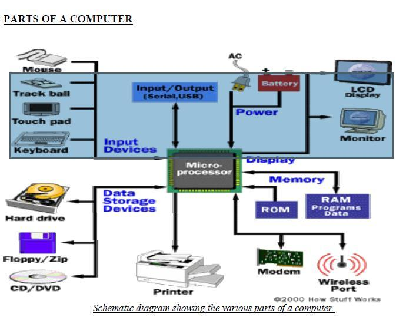

# 01 · Computer Systems: Foundations

## What a computer does

A **computer** is an electronic, programmable system that accepts data and instructions, processes them, stores them, and produces information. Its basic cycle is **input → processing → output**, with storage available throughout. **Data** are raw facts (such as `18, 21, 19`); **information** is data organized to be useful (such as an average age of 19.3).

**Hardware** is the physical equipment; **software** is the instructions that direct it. Neither is useful alone: an application needs hardware to run, and hardware needs software to perform useful tasks.

Computers are fast, consistent at repeated work, accurate when data and instructions are correct, able to store large amounts, and useful for many different tasks. They do not understand meaning or make dependable judgments by themselves. Incorrect data or instructions produce incorrect results (often summarized as *garbage in, garbage out*); computers also need power, maintenance, and human oversight.

## Development and types

Computing developed from tools such as the abacus and mechanical calculators to programmable machines. Charles Babbage proposed the Analytical Engine; later electronic generations became smaller, faster, more reliable, and more affordable:

| Generation | Main technology | Broad change |
|---|---|---|
| First | Vacuum tubes | Very large, hot machines; machine-language programming |
| Second | Transistors | Smaller, faster, less heat; wider use of high-level languages |
| Third | Integrated circuits | More components per chip; improved reliability and capacity |
| Fourth | Microprocessors | CPU on a chip; personal computers became practical |
| Fifth / current development | VLSI, parallel processing, AI research | Greater integration and increasingly capable systems |

These are broad historical groupings, not a claim that every computer changed at once. Computers are also grouped by purpose (general-purpose or special-purpose), portability (desktop, laptop, tablet, embedded), and capability (for example, servers and supercomputers).

## Number systems you should be able to work

Digital circuits represent information with two states, conventionally **0** and **1**. A **bit** is one binary digit; a **byte** is 8 bits. Decimal uses base 10; binary uses base 2; hexadecimal uses base 16 (digits 0–9 and A–F).

**Convert binary `1011₂` to decimal:** label places from right to left as 1, 2, 4, 8. Add the places with a 1: `8 + 0 + 2 + 1 = 11₁₀`.

**Convert decimal 13 to binary:** repeatedly divide by 2 and record remainders: `13→6 r1`, `6→3 r0`, `3→1 r1`, `1→0 r1`. Read remainders upward: `1101₂`.

Storage units are commonly written KB, MB, GB, TB. In binary-based teaching examples, 1 KB = 1,024 bytes; some modern storage labels use decimal multiples (1,000). State which convention you use if precision matters.

## Safety, ethics, and study

Use devices with good posture and lighting, take breaks, keep liquids away, protect equipment from heat and power surges, and shut down safely. Respect privacy, intellectual property, accessibility, and other users; verify information before relying on or sharing it. Use technology lawfully and credit sources.

:::mistakes
- A computer processes data; it does not guarantee that the result is true or sensible.
- Do not confuse hardware (touchable components) with software (programs and data).
- When converting binary, write place values first and read division remainders from bottom to top.
:::

## Active recall

1. Explain the input–process–output cycle using an example that includes stored data.
2. Name one defining technology for each of the first four computer generations.
3. Convert `10010₂` to decimal, then explain why a correct calculation can still produce a misleading result.
