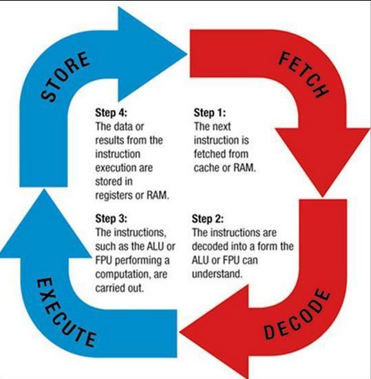

# 02 · Computer Hardware Components

## Main hardware units

The computer’s hardware works together through five functional groups:

1. **Input devices** enter data and commands: keyboard, mouse, touchscreen, microphone, scanner, camera, barcode reader, OCR (recognizes printed characters), and OMR (detects marked responses).
2. **The CPU (processor)** executes instructions. The **control unit (CU)** coordinates activity; the **arithmetic/logic unit (ALU)** performs calculations and comparisons; **registers** hold tiny amounts of data needed immediately.
3. **Primary memory** holds instructions and data currently in use. **RAM** is fast, volatile working memory; its contents normally disappear when power is removed. **ROM/firmware** retains essential startup instructions. **Cache** is very fast memory that keeps frequently needed data close to the CPU.
4. **Secondary storage** keeps files when power is off: SSDs, hard drives, USB flash drives, memory cards, and optical discs. SSDs have no moving parts; hard drives use magnetic rotating media. Back up important work to a separate, trusted location.
5. **Output devices** present results: monitor, printer, speakers/headphones, and projector. Printers may be impact (strike a ribbon, e.g. dot-matrix) or non-impact (e.g. inkjet, laser); impact models are typically noisier.

Some peripherals both receive and present information. A touchscreen is both input and output; a network adapter sends and receives data.

## What happens when you run a task?

When you calculate a total, the keyboard or mouse supplies input, the program and needed data are loaded from storage into RAM, the CPU fetches and executes instructions, and the result appears on screen or is saved. The CPU works on instructions; storage preserves data. This is why a machine can have ample disk space but still feel slow when RAM is insufficient.

## Practical distinctions

- **RAM vs. storage:** RAM is temporary working space; storage is long-term, non-volatile space.
- **Input vs. output:** a scanner captures a paper page; a printer produces a paper copy.
- **OCR vs. OMR:** OCR turns image text into editable characters; OMR detects filled marks on a designed form.
- **Capacity vs. speed:** capacity is how much can be kept; speed is how quickly it can be read or written.

### A safe peripheral workflow

1. Check that the device and cable/port are compatible; never force a connector.
2. Connect or pair it as directed, then allow the operating system to install or select a trusted driver.
3. Test with a small, non-sensitive file (for example, print one page).
4. Save or eject removable media safely before unplugging it. Do not remove a drive while it is writing.

## Safety and care

Keep vents unobstructed; avoid static discharge when handling internal parts; use dry hands and appropriate power protection; never open a powered device. Keep food and liquids away. Use headphones at a safe volume and adjust screen, chair, and keyboard to reduce strain. Recycle batteries and electronic waste through approved channels. Ask for authorization before inspecting another person’s files or connecting equipment to a managed network.

:::mistakes
- RAM is not the same as a hard drive or SSD; one is working memory and the other is persistent storage.
- The CPU does not permanently store all your documents.
- A scanner is input; a monitor and projector are output. A multifunction device may perform both.
:::

## Active recall

1. Trace the path of a typed number through input, memory, CPU, and output.
2. Compare RAM, ROM, cache, and secondary storage by purpose and persistence.
3. Choose an input and output device for digitizing a printed questionnaire and explain why.
