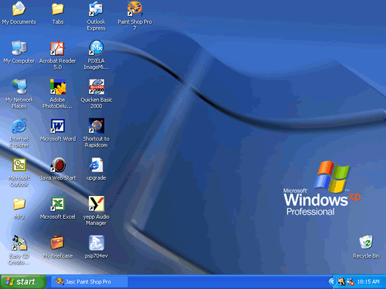

# 04 · Windows and Operating Systems

## What the OS does

An **operating system (OS)** is system software that provides the user interface and coordinates programs, CPU time, memory, files, storage, and peripheral devices. Windows presents a graphical interface with windows, menus, icons, and a pointer. Common desktop elements include the Start menu, taskbar, notification area, File Explorer, and Recycle Bin.

When a computer starts, firmware performs initial checks (POST), finds a boot device, loads the OS, and presents the sign-in screen. A **cold boot** starts from power off; a **restart/warm boot** reloads the system without a full power-off. Save work before either.

## File and folder procedure

Use File Explorer to organize work rather than leaving files scattered on the desktop.

1. Open File Explorer and choose a suitable location, such as Documents or an approved course folder.
2. Select **New folder**, give it a clear name (for example, `CSC111_Revision`), and press Enter.
3. Open that folder; create descriptive filenames such as `network-notes.docx`.
4. Save a new document with **Save As** to choose its location and format. Use **Save** for later changes.
5. To move a file, select it and use **Cut** then **Paste** at the destination; use **Copy** when you need to keep the original too.
6. Check the destination and filename before deleting anything. Deleted files may be recoverable from the Recycle Bin until it is emptied.

A **path** identifies a file’s location, such as `Documents\CSC111\week1.docx`. A **file extension** (such as `.docx` or `.xlsx`) indicates the file type; changing the visible name alone does not reliably convert the format. A shortcut points to an item; it is not a second copy of the file.

### Find and manage a file

- Search by a distinctive filename or part of it; check the current folder and filters if no result appears.
- Rename using a clear, descriptive name; avoid changing the extension.
- Back up important files to an approved separate location. Cloud synchronization is useful but is not the same as an independent backup.
- Use **Lock** when stepping away briefly; **Sign out** ends your session; **Restart** reloads Windows. Choose the option appropriate to the situation.

## Accounts, privacy, and maintenance

Use your own account, a strong unique password, and a screen lock. Do not share credentials or store them in plain text. Install updates and applications only through trusted, authorized channels. Check permissions before sharing folders. Follow school/work policy for removable drives and cloud storage. Before disposing of a device, have its data securely erased by an authorized process.

Maintain good posture, keep vents clear, protect devices from liquid and heat, and shut down through the operating system. Forced power-off can lose unsaved work or damage files; use it only when normal controls have failed.

:::mistakes
- A shortcut is a link to a file or program, not the file itself.
- Save As changes the destination/name/format; Save updates the current document.
- Moving a file differs from copying it. Verify the destination before removing the source.
- Do not empty the Recycle Bin until you are sure you no longer need its contents.
:::

## Active recall

1. List the stages from pressing the power button to the Windows sign-in screen.
2. Describe how to create a course folder, save a document into it, and verify the saved file.
3. Compare Lock, Sign out, Restart, and Shut down; give one appropriate use for each.
