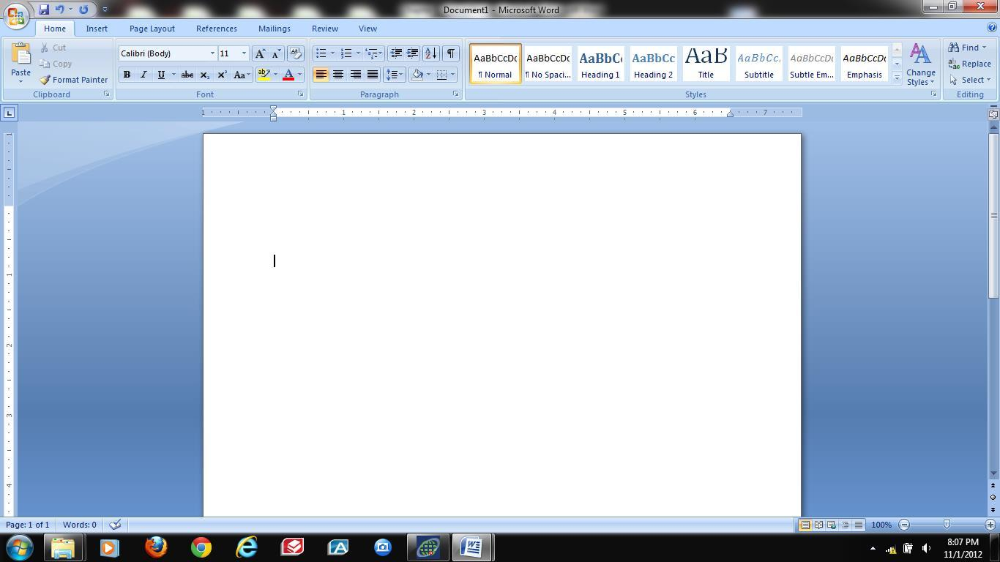

# 06 · Word Processing

## Build a clean document

A **word processor** creates, edits, formats, saves, and prints text documents. In Word, the ribbon groups commands (for example, Home, Insert, Layout, References, Review). Start with a clear purpose and structure before decorating the page.

### Create, save, and format

1. Open Word and choose **Blank document** or an approved template.
2. Type or paste your content; use **Save As** early to choose the course folder, a descriptive filename, and `.docx`. Save regularly with Ctrl+S.
3. Organize content with built-in **Heading 1/Heading 2** styles and Normal for body text. Use a consistent, readable font and size.
4. Set page size, orientation, and margins from **Layout**. Use paragraph spacing and line spacing consistently; use alignment and indentation intentionally.
5. Use numbered or bulleted lists for genuine sequences or groups. For page layout, use page breaks rather than repeated blank lines.
6. Add tables from **Insert → Table** when information is naturally tabular. Add meaningful headers; keep tables simple and readable.
7. Insert a picture from **Insert → Pictures**, resize using a corner handle to preserve proportions, set suitable text wrapping, and add alt text if available. Use only images you may lawfully use and cite them when required.
8. Add headers, footers, and page numbers from **Insert** when helpful. Use **References** tools for a table of contents, citations, or footnotes.

**Styles** apply consistent formatting and structure; manual formatting changes only the selected text. Headings based on styles can be used to generate a table of contents.

### Review and submit

1. Run spelling and grammar checks from **Review**; accept suggestions only when they preserve your intended meaning.
2. Use Find/Replace carefully. Review each replacement where context matters.
3. Use **File → Print** to inspect print preview, page count, margins, page breaks, and grayscale/readability.
4. Save, reopen the saved copy if practical, and confirm the filename and destination before submitting.

### Mail merge in brief

Mail merge combines a template (for example, a letter) with a recipient data source (for example, a spreadsheet). Prepare clean column headings and one person per row, select **Mailings → Start Mail Merge**, connect the list, insert fields such as Name, preview several records, correct errors, and finish/print only the intended set. Protect recipient data and do not send a test to the full list.

## Common pitfalls and good practice

Use one space after sentences; avoid aligning text with repeated spaces. Do not press Enter repeatedly to force a new page. Check that a heading is a real heading style, not merely large bold text. Keep a backup before major edits; use Track Changes or comments when collaborative review is required. Proofread names, dates, page numbers, citations, and confidential content. Use accessible contrast, descriptive link text, and alt text. Follow the assignment’s file format and naming rules.

:::mistakes
- Ctrl+S saves the current file; it does not create a separately named copy. Use Save As for a new copy.
- Formatting text to look like a heading is not the same as applying a heading style.
- Spell-check may miss real-word errors (for example, “form” instead of “from”); proofread manually.
- Check print preview: on-screen layout can hide page breaks, clipped tables, or missing content.
:::

## Active recall

1. Give the steps to create a styled report with a title, section headings, page numbers, and a saved `.docx` copy.
2. Explain why page breaks and heading styles are better than repeated blank lines and manual bolding.
3. Outline a safe mail-merge workflow and identify two checks to make before sending.
