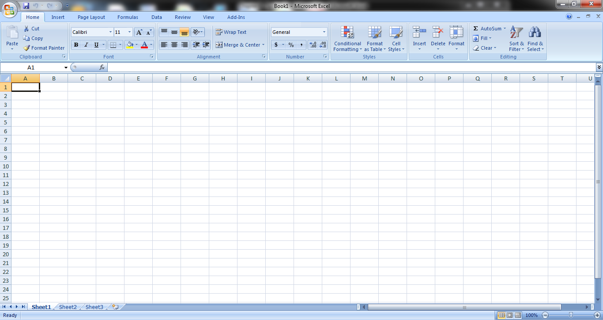

# 07 · Spreadsheets and Excel

## Workbook structure and data

An Excel **workbook** is a file containing one or more **worksheets**. Rows are numbered; columns are lettered. Their intersection is a **cell**, addressed by column then row (for example, `B3`). A **range** is a group of cells (for example, `B2:B6`). The active cell is where typed data or a formula will go.

Text labels describe data; numbers, dates, and times can be values used in calculations. Format controls how a value appears, not its underlying value. Use one header row, one record per row, one variable per column, and avoid blank rows inside a data table.

### Enter and calculate

1. Open a blank workbook and save it as `.xlsx` in the right folder.
2. Enter descriptive headings (for example, `Item`, `Quantity`, `Unit price`, `Total`) and data beneath the matching columns.
3. Click the result cell and begin every formula with `=`.
4. Use cell references rather than retyping values. For example, if quantity is `B2` and unit price is `C2`, enter `=B2*C2` in `D2`.
5. Press Enter; inspect the result and formula bar. Fill the formula down when appropriate, then spot-check a row.

Common functions: `=SUM(D2:D6)` adds values; `=AVERAGE(D2:D6)` returns their mean; `=MIN(D2:D6)` and `=MAX(D2:D6)` find extremes; `=COUNT(D2:D6)` counts numeric cells. Example: totals `12, 15, 18` yield `SUM = 45`, `AVERAGE = 15`.

**Relative references** adjust when copied (`B2` becomes `B3`). **Absolute references** stay fixed (`$B$1`), useful for a constant tax rate: if `E2` is subtotal and `$B$1` is the rate, use `=E2*$B$1`. Mixed references lock only a row or column (e.g. `$B2`, `B$2`).

### Make data useful

- Format numbers as currency, percentages, or dates to match their meaning; do not type a currency symbol into every numeric value.
- Sort the entire table by a chosen field, keeping headers identified. Filter to show matching rows without deleting the others.
- Create a chart by selecting the relevant labels and values, then **Insert → Chart**. Choose a chart that fits the comparison or trend; include a meaningful title and labeled axes where useful.
- Use print preview, set orientation/scaling if needed, and confirm that all columns and headings are visible.
- Save as `.xlsx` to retain formulas and formatting. CSV stores plain tabular text and generally does not preserve multiple sheets, formatting, or formulas as formulas.

## Troubleshooting and care

`####` often means a column is too narrow; widen it. `#DIV/0!` means division by zero or a blank denominator. `#VALUE!` often indicates an unexpected type; `#NAME?` may mean a misspelled function or missing text quotes. A result that does not update may be text rather than a formula or may use incorrect calculation settings.

Protect original data before sorting, deleting, or overwriting; keep a copy and use Undo when appropriate. Do not expose personal data in shared workbooks. Use clear labels, appropriate precision, and honest chart scales—visualizations should not mislead.

:::mistakes
- A formula starts with `=`; typing `B2*C2` without it displays text instead of calculating.
- `=SUM(B2:B6)` includes both endpoints; a comma-separated list such as `=SUM(B2,B6)` is different.
- A number format changes display, not the stored value. Check formulas and references, not only what appears on screen.
- Sort whole records, not one column alone, or values can become associated with the wrong person/item.
:::

## Active recall

1. In `B2:B6`, enter 8, 12, 10, 15, 5. Write formulas for their total and average and calculate each result.
2. Explain the difference between `B1` and `$B$1` when a formula is copied down.
3. Describe how to sort/filter a table and make a chart without separating data from its labels.
